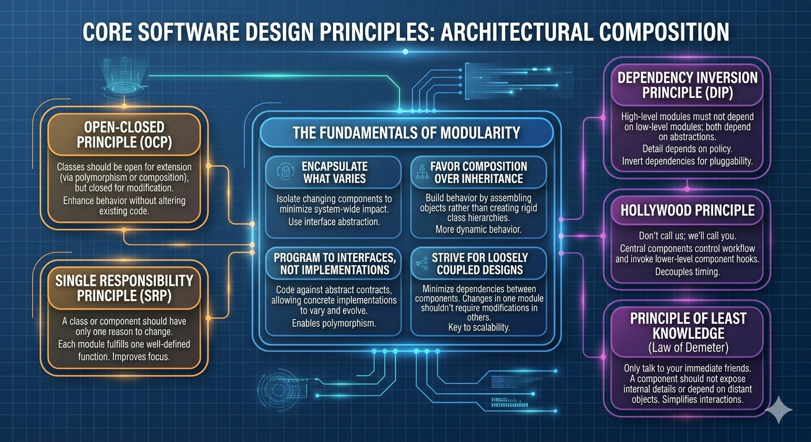
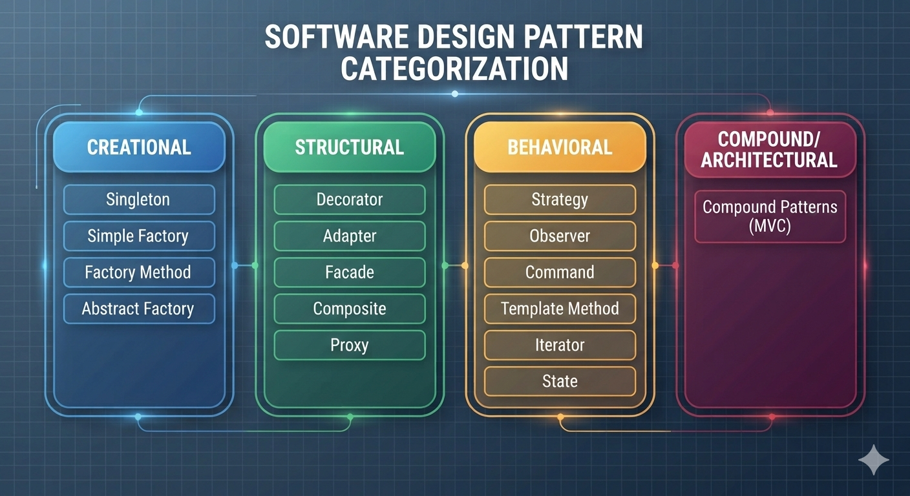
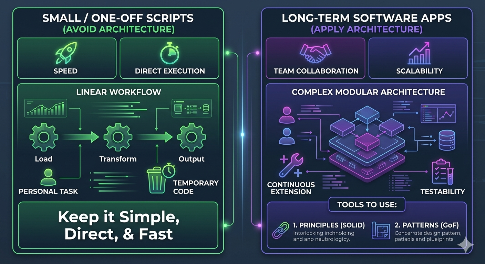

# Reimagining Design Patterns in Python 🐍
Most classic design patterns were written from the perspective of statically-typed languages like Java, which have rigid syntactic constraints. Python, however, offers dynamic alternatives—such as first-class functions, decorators, and built-in modules—that make many traditional patterns redundant or drastically simpler.

# Principles
- Encapsulate what Varies.
- Favor Composition over Inheritance.
- Program to Interfaces, not Implementations.
- Strive for Loosely coupled designs between objects that Interact.
- Classes should be Open for extension but Closed for modification.(Open-Closed Principle)
- Depend on Abstractions. Do not depend on concrete classes. (Dependency Inversion Principle)
- Only talk to your Immediate friends. (Principle of Least Knowledge / Law of Demeter)
- Don't call us, We'll call you.(Hollywood Principle)
- A class should have only one reason to change(Single Responsibility Principle)

# Patterns
- Strategy
- Observer
- Decorator
- Simple Factory
- Abstract Factory
- Factory Method
- Singleton
- Command
- Adapter
- Facade
- Template Method
- Iterator
- Composite
- State
- Proxy
- Compound Patterns(MVC)

# When to Avoid and Use Design Principles and Patterns
